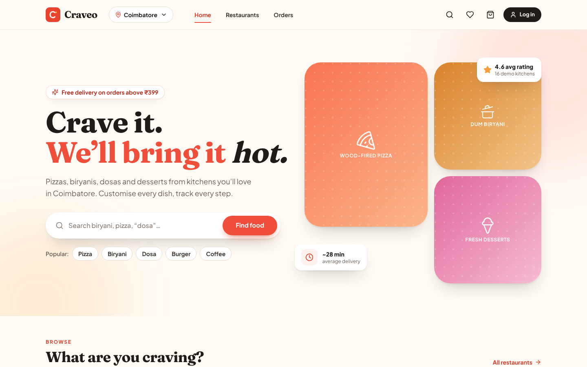
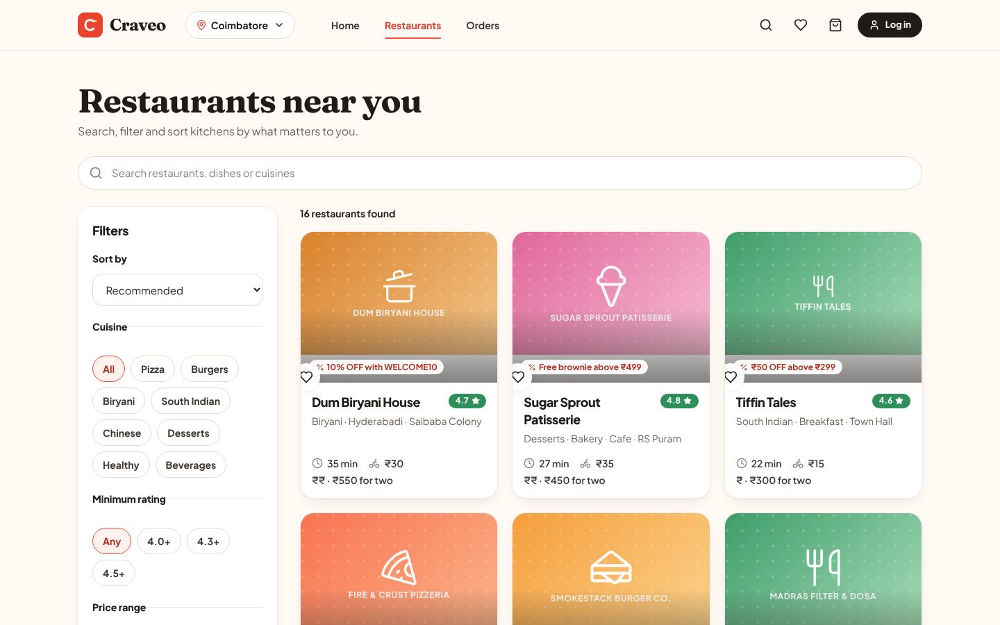
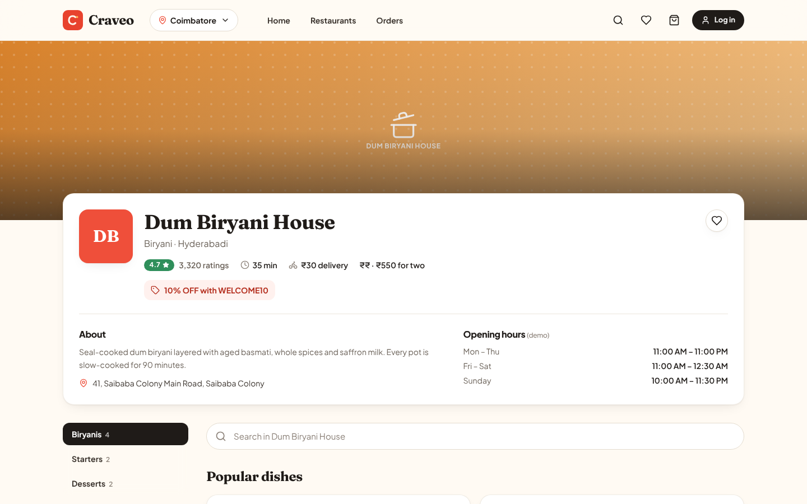
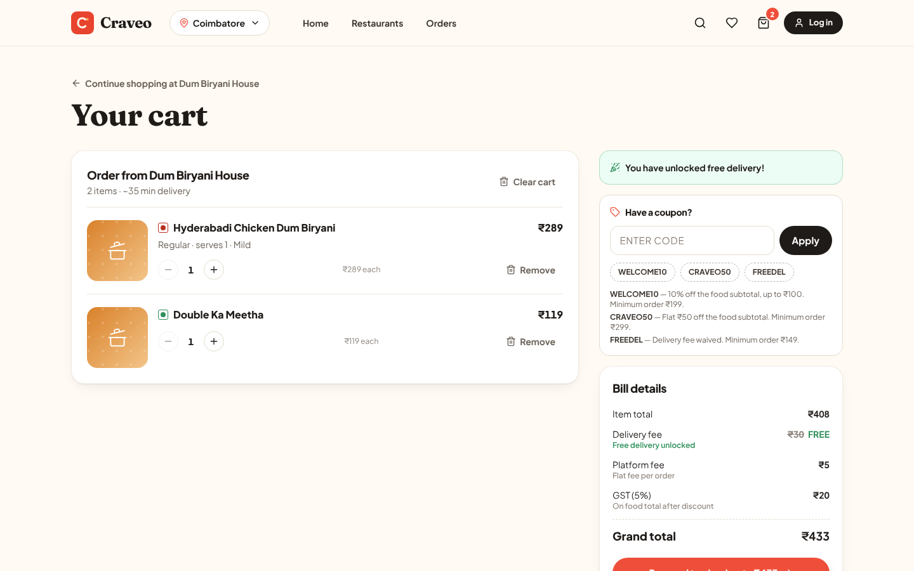
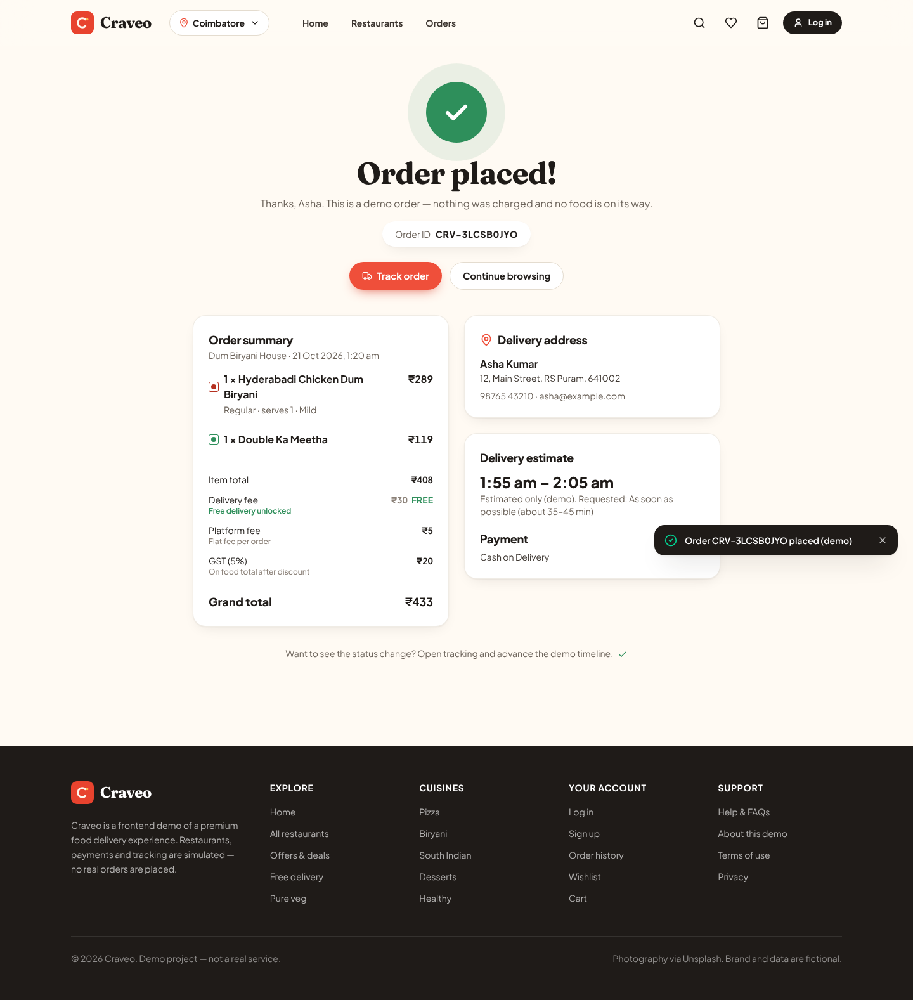
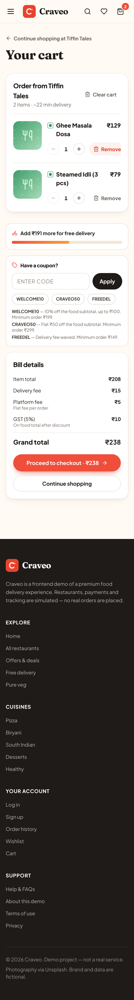

# Craveo — Premium Food Delivery Platform (frontend demo)

Craveo is a complete, frontend-only food delivery experience built with React, Vite and Tailwind CSS.
Browse restaurants, customise dishes, build a cart, apply coupons, check out, and follow a simulated order
timeline. **Everything runs in the browser with local demo data — there is no backend, no real payment,
no real authentication and no live tracking.**

> Live demo: _placeholder — add your Vercel/Netlify URL after deploying_
> Repository: _placeholder — add your GitHub URL after pushing_

## Features

- **Home** — hero with search, 10 category tiles, offer banners (copyable codes), featured / trending / top-rated restaurants, popular dishes, Plus membership promo, how-it-works, testimonials, footer.
- **Restaurants** (`/restaurants`) — keyword search (restaurant, dish, cuisine), cuisine filter, sort (recommended, rating, delivery time, price), min-rating, price level, free delivery, offers, pure-veg; active filter chips, clear-all, result count, **Load more** pagination, empty state. Filters live in the URL, so they survive refresh and can be shared.
- **Restaurant details** (`/restaurant/:id`) — cover, about, demo opening hours, sticky category navigation with scroll-spy, in-menu search, popular dishes, veg/spicy markers, wishlist hearts.
- **Customisation modal** — required options (validated), optional add-ons with limits, quantity, special instructions, live price. The same dish with different options/notes becomes **separate cart lines**; identical ones merge.
- **Cart** — quantity stepper, remove, clear (with confirmation), coupons, free-delivery progress, itemised bill. One restaurant per cart (a dialog asks before replacing).
- **Checkout** — contact, address, delivery time, payment method (COD / demo UPI / demo card), inline validation, loading state, double-submit protection, order snapshot saved to LocalStorage, cart cleared only after the order exists.
- **Order confirmation / tracking / history** — success animation, 5-stage timeline, demo delivery partner, reorder, persistent after refresh.
- **Auth (frontend demo)** — `/login`, `/signup` and `/forgot-password` render inside a dedicated `AuthLayout` (route-level, no main Navbar/Footer), with a Back to Home link. Signup validates name, email, password strength and confirm-password, blocks duplicate emails, and signs you in; login works for any account created through signup; the session survives refresh and **Log out** is in the profile menu.
- **Forgot password (demo only)** — validates the email, simulates a request, then states clearly that **no email is sent and no password is changed** (there is no backend). It never reveals whether an account exists.
- **Wishlist**, **Help/FAQ**, **About / Terms / Privacy**, **404**.

## Tech stack

React 19 · Vite 7 · Tailwind CSS 4 · React Router 7 · Context API + reducer · Framer Motion · LocalStorage · Lucide icons · self-hosted fonts (Fraunces, Plus Jakarta Sans via Fontsource).

## Getting started

```bash
npm install
npm run dev          # http://localhost:5173
npm run build        # production build to dist/
npm run preview      # serve the build at http://localhost:4173
npm run lint         # ESLint
npm run test:logic   # Node tests for pricing, coupons, cart keys, validation, filters, reorder
```

Requires Node 18+ (developed on Node 22).

## Folder structure

```
src/
  components/ layout/ common/ restaurant/ menu/ cart/ checkout/ orders/ home/
  pages/        one file per route
  context/      Auth, Cart, Wishlist, Orders, Location, Toast providers
  data/         restaurants, categories, option presets, static content, image pools
  hooks/        modal behaviour, click-outside, add-to-cart, reorder, page title
  utils/        pricing & coupons, validation, storage, formatting, filters, ids
  routes/       route table (pages are lazy-loaded)
scripts/        logic-tests.mjs
screenshots/    real captures from the running app
```

## Pricing rules

```
item total   = Σ unit price × quantity
discount     = coupon discount on item total (never more than the item total)
delivery fee = restaurant fee; waived if item total ≥ ₹399, with FREEDEL, or for demo Plus members
platform fee = flat ₹5
GST          = 5% of (item total − discount), rounded to the nearest rupee
grand total  = max(0, item total − discount + delivery + platform fee + GST)
```

## Demo coupons

| Code | Effect | Eligibility |
| --- | --- | --- |
| `WELCOME10` | 10% off item total, max ₹100 | min ₹199 |
| `CRAVEO50` | flat ₹50 off | min ₹299 |
| `FREEDEL` | delivery fee waived | min ₹149 |
| `SUMMER25` | expired — demonstrates the error message | — |

Only one coupon at a time. If quantity changes make a coupon ineligible, the discount stops and the reason is shown.

## Demo behaviour and limitations

- **Authentication is a local demo.** Accounts exist only in this browser's LocalStorage; passwords are salted + SHA-256 hashed with the Web Crypto API (never stored raw). This is **not** production security. A "Continue as demo guest" button is the only fixed demo identity (no shared demo password). Signing up with a new account is the way to test login.
- **Payments are not processed.** COD / UPI / card are simulated; no card fields exist. Never enter real details.
- **Tracking is simulated.** Use *Next status* or *Auto-play* on the tracking page. There is no GPS/driver data. Delivery partners are labelled demo data.
- All data (cart, wishlist, orders, session, city) lives in LocalStorage under `craveo.*` keys; malformed data is ignored safely.
- The city selector is cosmetic — every city shows the same demo restaurants.
- **Images:** food photos are Unsplash URLs (see `src/data/images.js`). Each `<FoodImage>` falls back to a generated illustrated tile if a photo fails to load. The photo IDs were chosen from memory and could **not** be network-verified in the build sandbox (it blocked `images.unsplash.com`), so check them in a normal browser and swap any that 404 — or replace with your own files in `public/`.

## Catalog

19 restaurants, 131 distinct menu items (every restaurant has 5+), 10 categories: Pizza, Burgers, Biryani, North Indian, South Indian, Chinese, Rolls & Wraps, Desserts, Healthy, Beverages. Mix of veg / non-veg, three price levels, Bestseller / Chef's pick / % off labels (`originalPrice` is display-only; the cart always charges `price`), and customisation groups on most dishes. `npm run test:logic` verifies ID uniqueness, restaurant↔item links, categories, filters and search against this data.

> Images are remote Unsplash photos with a generated illustrated fallback tile. The photo IDs could not be checked from the build sandbox (no internet), so if any are dead the fallback tile is shown instead; swap IDs in `src/data/images.js` as needed.

## Order tracking simulation

Orders start at *Order placed* → *Confirmed* → *Preparing* → *Picked up* → *Delivered*. The current stage and timestamps are saved with the order, so the page is correct after a refresh.

## Deployment

SPA rewrites are already configured (`vercel.json`, `netlify.toml`).

**Vercel:** push to GitHub → *Add New Project* → import → framework *Vite* (build `npm run build`, output `dist`) → Deploy.
**Netlify:** *Add new site → Import from Git* → build `npm run build`, publish `dist` (read from `netlify.toml`) → Deploy. Or drag the `dist/` folder after `npm run build`.

## GitHub upload

```bash
git init && git add . && git commit -m "Initial commit: Craveo food delivery demo"
git branch -M main
git remote add origin <your-repo-url>
git push -u origin main
```

## Screenshots

Real captures from the running app are in [`screenshots/`](./screenshots): desktop home, listing, restaurant menu, customisation modal, cart, checkout, confirmation, tracking; tablet home/listing; mobile home, drawer and cart.
Note: they were captured in a sandbox without access to Unsplash, so food photos appear as the built-in illustrated fallback tiles. To recapture with photos, run `npm run dev`, open each page at 1440×900 / 768×1024 / 375×812 in browser DevTools and use *Capture screenshot*.








---

# Craveo Admin Panel

An integrated, responsive admin panel living in the same Vite/React project (`src/admin/`). It reuses the existing contexts, LocalStorage persistence, pricing/coupon logic, Framer Motion and Tailwind theme. **It is a front-end demo: there is no backend, payment provider, email/SMS service, GPS tracking or real identity verification.**

## Run it

```bash
npm install
npm run dev            # then open http://localhost:5173/admin
npm run test           # existing logic tests + admin logic tests
npm run lint && npm run build
```

### Demo admin accounts (demo credentials only)

| Role | Email | Password |
|---|---|---|
| Super Admin | `super@craveo.demo` | `Super@12345` |
| Operations | `ops@craveo.demo` | `Ops@12345` |
| Restaurant Manager | `restaurants@craveo.demo` | `Rest@12345` |
| Finance | `finance@craveo.demo` | `Fin@12345` |
| Support | `support@craveo.demo` | `Sup@12345` |

On `/admin/login`, clicking a demo card fills **both** the email and the password (use the eye icon to reveal it), shows the selected role, and **Sign in** then goes to `/admin`. The same pairs, if you type them by hand (case-sensitive, no spaces):

Customer accounts cannot sign in to `/admin` (separate accounts and session). Only salted SHA-256 hashes are stored; raw passwords are never written to LocalStorage.

## Getting to the admin panel

From the customer site use the **Admin Panel** button in the navbar (desktop/tablet), the **Admin Panel** item in the mobile menu, or **Admin Access** in the footer. All go to `/admin/login`; after signing in you land on `/admin`. Opening any `/admin/*` URL while signed out redirects to `/admin/login` and returns you to that page after login (the role's permissions still decide what you can see). SPA deep links work on Netlify via `netlify.toml` and `public/_redirects`, and on Vercel via `vercel.json`.

## Routes

`/admin/login` · `/admin` (dashboard) · `/admin/orders` (`?tab=pending|confirmed|active|delivered|cancelled|refunds`) · `/admin/restaurants` (`?tab=applications`) · `/admin/menu` · `/admin/delivery-partners` (`?tab=verification|assignments`) · `/admin/customers` · `/admin/finance` (`?tab=transactions|settlements|payouts|refunds|tax|rules`) · `/admin/promotions` · `/admin/support` · `/admin/reports` · `/admin/settings` · `/admin/roles` · `/admin/audit-logs` · `/admin/notifications`

## The eight modules

1. **Dashboard & analytics** – orders, net revenue, AOV, active customers, restaurant/partner summaries, sales trend, peak hours (from order timestamps), status distribution, top foods/restaurants, recent orders & activity, daily/weekly/monthly buckets, preset and custom date ranges, growth vs the previous equal period (only when history exists), live vs demo data filter.
2. **Orders** – seven views (all, pending, confirmed, active deliveries, delivered, cancelled, refund requests); search by order ID/customer, status/date/source filters, sorting, pagination; detail view with items, pricing, customer, delivery, payment, timeline; valid transitions only (no skipping, picked-up needs an assigned partner); cancellation with reason; refund review (approve/reject with reasons). Changes are written to the customer's own order history and tracking page.
3. **Restaurants & menu** – listing, registration, details, approve/reject applications, document review (file names only), active/inactive, hours, cuisine, ratings, commission settings (0–40 %, 0.5 steps, calculation basis shown), validated add/edit/delete with confirmations; menu items with availability, customisation option groups, categories, filters, sorting. Approved + active restaurants and their menu edits appear in the customer app (sold-out dishes show "Sold out" and can't be added to the cart).
4. **Delivery partners** – listing, registration, documents, verification, online/offline (manual), assignment/reassignment (validated: verified, active, online, under the active-delivery limit), delivery history, simulated earnings, completion/cancellation metrics.
5. **Customers** – registered, guest and demo customers (clearly labelled), contact info, order history, addresses taken from past orders, refunds, reviews (demo only – the storefront has no review feature), tickets, account status (active/suspended/blocked, with reason + confirmation). A suspended/blocked **registered** account is refused at customer login.
6. **Payments & finance** – derived payment states (success/pending/failed/refunded), transactions, restaurant settlements, partner payouts, commission, refunds, tax summary, CSV export, date filters.
7. **Offers & promotions** – coupon create/edit/activate/delete with validation, campaigns, referral configuration, usage records and campaign analytics derived from orders. Admin coupons are published into `utils/pricing.js`, so the **same** `validateCoupon`/`calculateTotals` code used by the cart enforces them.
8. **Support, reports, settings** – tickets (priority, category, status transitions, assignment, conversation, dispute resolution notes), in-app notification centre, sales/order/restaurant/delivery/commission-and-refund reports with CSV export, delivery zones, platform settings (fees, GST, ETA buffer, refund window, commission, payouts), roles & permission matrix, audit logs.

## Persistence

- Customer data keeps its existing keys. Admin state lives in `craveo.admin.v1`, the admin session in `craveo.adminSession.v1`.
- On first load, sample data is generated deterministically and stored under the admin key; every sample record is flagged `demo` and shown with a **Demo** badge. Live customer orders/accounts are never mixed into the demo store.
- Every section of stored admin data is validated on load; malformed or outdated sections fall back to defaults independently, and at least one active Super Admin is always restored.
- Catalog/coupon/pricing changes are re-applied at startup (`initAdminRuntime`) so the customer app sees them without opening the admin panel. Customer pages read the catalog when they mount, so navigate to a customer page to see menu edits.
- Pricing, GST, platform fee, ETA buffer and refund-window changes affect **new orders only**; saved orders keep their totals. Commission rates are snapshotted per order the first time the panel sees it, so rate changes never rewrite history.

## Finance calculation rules

```
foodNet           = subtotal − discount
commission        = round(foodNet × rate ÷ 100)        (rate: restaurant override, else default 15 %, frozen per order)
restaurantPayable = foodNet − commission
GST collected     = as saved on the order (shown separately, not revenue)
partnerPayout     = flat ₹30 per delivered order (Settings)
deliveryMargin    = delivery fee collected − partnerPayout
platformNet       = commission + platform fee + deliveryMargin
gross order value = Σ totals of non-cancelled orders
net revenue       = gross − approved refunds
```
Check: `restaurantPayable + commission + delivery fee + platform fee + GST = order total`. Settlements and payouts include only delivered orders without an approved refund, each order at most once. "Paid" means paid in the simulated ledger only. If a refund is approved after settlement, the Finance overview flags it for manual adjustment.

## Authentication & permission limitations (read this)

- Admin sign-in, roles, permissions, the audit log and account status are all **client-side**. Anyone with DevTools can edit LocalStorage, change a role, bypass a hidden button or clear the audit log. **Real authorization must be enforced by a backend.**
- The audit log is local demo data, not a tamper-proof record. The role matrix hides pages, blocks actions inside the browser and keeps least-privilege defaults, nothing more.
- Login has a small client-side attempt lock-out; this is not rate limiting.
- The customer demo auth (hash in LocalStorage) is unchanged apart from the account-status check.

## Known limitations

No real payments/refunds/payouts, emails/SMS, GPS, geospatial delivery-zone validation, document upload (only file names), referral rewards, customer-side ticket creation or review capture, server-side persistence or multi-device sync. Currency/locale settings are stored but the storefront formats INR. Coupon eligibility is limited to what the cart supports (minimum order, max discount, dates, usage limit, active flag).


## Real admin accounts (server-verified login)

The demo accounts above are checked **in the browser** and are for training only. Any *other* email on `/admin/login` is verified by a real server-side endpoint, `netlify/functions/admin-auth.mjs`:

- Passwords are verified against **scrypt** hashes (salted, constant-time compare); no plaintext is stored anywhere.
- A successful login sets a signed, **HttpOnly, Secure, SameSite=Strict** session cookie (8 h). Browser JavaScript can't read it; nothing sensitive goes into LocalStorage.
- The role in the session is read from the server configuration on every check, so a role change or removal there takes effect immediately.
- Login is refused (HTTP 503, with a clear message) unless the server is configured, 5 bad attempts lock an email/IP for a minute (best-effort: serverless instances don't share memory), cross-origin and non-JSON requests are rejected, and unknown emails get the same response as wrong passwords.

### Configure it (Netlify)

1. Create a password hash for each admin (type it when prompted; it is never written to disk or the command line):
   ```bash
   node scripts/hash-admin-password.mjs
   ```
2. In Netlify → Site settings → Environment variables add (**no `VITE_` prefix**, never commit them):
   - `ADMIN_SESSION_SECRET` – a random string of 32+ characters
   - `ADMIN_ACCOUNTS` – JSON, e.g. `[{"name":"Your Name","email":"you@example.com","role":"super_admin","passwordHash":"scrypt$16384$…"}]` (roles: `super_admin`, `operations`, `restaurant_manager`, `finance`, `support`)
3. Optional, for a production deployment: set `VITE_DEMO_ADMIN=false` to switch off the demo accounts and their autofill.
4. Redeploy. Locally, use `netlify dev` (with the variables in a git-ignored `.env`, see `.env.example`); plain `npm run dev` has no functions, so real-account login shows "not configured" there.

Accounts are provisioned by an operator through this configuration — there is no self-registration for admins.

### Honest limits

- The function authenticates users and asserts their **role**, but the admin panel's data (orders, menus, audit log…) still lives in the browser's LocalStorage, so permissions on that data are enforced in the UI only. A full backend API with server-side authorization is the next step for production.
- Demo accounts remain a client-side check and are not secure.
- Covered by `npm run test:auth` (handler tested directly in Node). Not yet verified on a deployed site.
